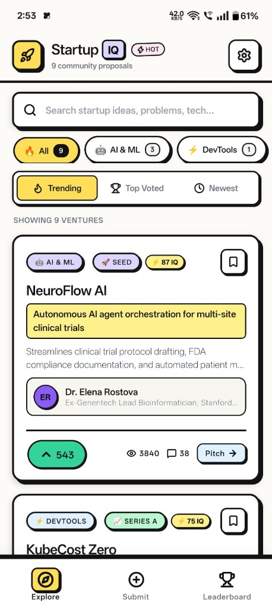
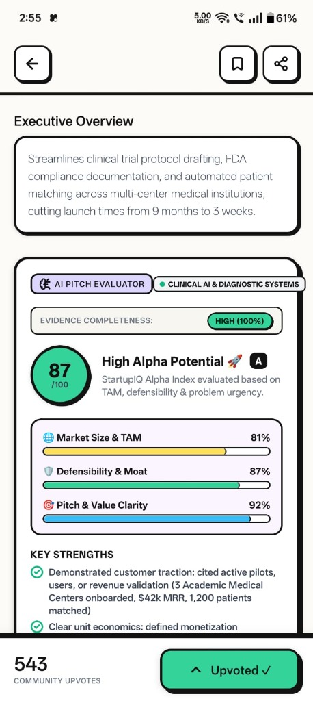
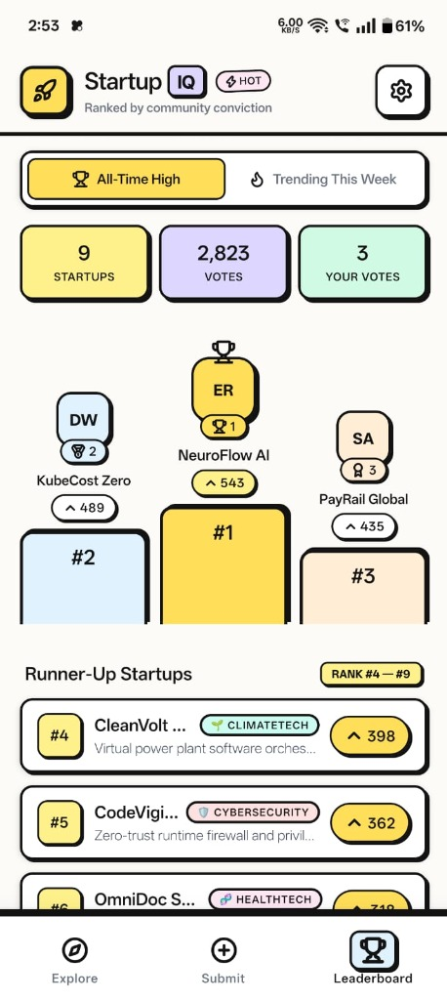
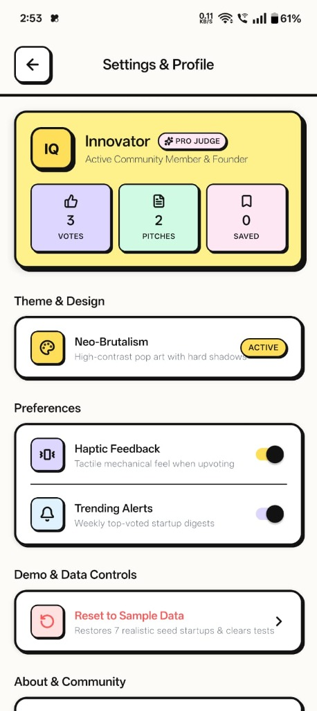

# 🚀 StartupIQ — Neo-Brutalist Startup Validation & Pitch Intelligence

[](https://reactnative.dev/)
[](https://expo.dev/)
[](https://docs.expo.dev/router/introduction/)
[](https://github.com/vjshriram157/startupIQ)
[](https://expo.dev/artifacts/eas/vEdr-o8c38p6ePq2a16_-VCgQRMdAr0yWhUGcDr-qGs.apk)
[](https://youtube.com/shorts/vKB9qd9yAqE?si=bpK29_-x_sc3ZRE_)
[](LICENSE)

> **StartupIQ** is a mobile-first startup validation and community intelligence application built with **React Native** and **Expo SDK 58**. It combines high-contrast **Neo-Brutalist** aesthetics with a **100% offline, content-aware heuristic AI Pitch Evaluator**, interactive milestone roadmap tracking, investor feedback loops, and robust local persistence.

---

## 🎥 Application Walkthrough & Video Demo

Watch the complete live walkthrough demonstrating the Neo-Brutalist interface, AI Pitch Evaluator, Milestone Tracker, and live upvoting:

<div align="center">
  <a href="https://youtube.com/shorts/vKB9qd9yAqE?si=bpK29_-x_sc3ZRE_">
    
  </a>
  <p>
    ▶️ <a href="https://youtube.com/shorts/vKB9qd9yAqE?si=bpK29_-x_sc3ZRE_"><strong>Click here to watch the full walkthrough on YouTube</strong></a>
  </p>
</div>

---

## 📥 Standalone Android APK Download

Install and run StartupIQ on any Android device without Expo Go or a computer:

👉 [**Download StartupIQ v1.0.0 Standalone APK (.apk)**](https://expo.dev/artifacts/eas/vEdr-o8c38p6ePq2a16_-VCgQRMdAr0yWhUGcDr-qGs.apk)

- **File Name**: `StartupIQ-v1.0.0.apk`
- **File Size**: ~94.6 MB
- **Package ID**: `com.startupiq.app`
- **Target OS**: Android 8.0+ (API level 26 to 35+)
- **Build Mode**: Standalone Internal Release (`preview` profile via EAS Build)

---

## 📱 Application Screenshots

Explore the high-contrast Neo-Brutalist interface, live interactive features, and on-device AI evaluation:

| 🔍 Explore & Filter Feed | 🤖 Content-Aware AI Pitch Evaluator |
| :---: | :---: |
| <br />**Explore & Filter Feed**<br />*Live keyword search, domain chips, sort tabs, and real-time upvote counters.* | <br />**AI Pitch Evaluator ("StartupIQ Score")**<br />*Neo-Brutalist meter, TAM, Defensibility, Clarity bars, and 100% Evidence Completeness.* |
| 💡 Founder Pitch Submission | 🏆 Community Podium Leaderboard |
| <br />**Founder Pitch Lab**<br />*Validated submission flow with pitch ranking tips, domain tags, and pricing models.* | <br />**Dynamic Leaderboard & Top 3 Podium**<br />*Gold, Silver, and Bronze pedestals with real-time re-ranking by community upvotes.* |
| ⚙️ Settings & Innovator Profile | 🚀 Standalone Android APK |
| <br />**Settings & Innovator Profile**<br />*Community judge credentials, haptic feedback toggle, and one-tap seed data restoration.* | <br /><br />📦 **Standalone Distribution Ready**<br /><br />• **100% On-Device Heuristic Engine** (Zero external APIs)<br />• **Native AsyncStorage on SQLite**<br />• **EAS Cloud Compiled APK** (`com.startupiq.app`)<br />• **No Expo Go or Local Server Required**<br /><br />👉 [**Download Standalone APK (.apk)**](https://expo.dev/artifacts/eas/vEdr-o8c38p6ePq2a16_-VCgQRMdAr0yWhUGcDr-qGs.apk)<br /><br /> |

---

## ✨ Key Features

### 1. 🤖 Offline Content-Aware AI Pitch Evaluator
- **Zero API Keys & Zero External Dependencies**: Powered by an on-device heuristic natural language analysis engine. Operates instantly with no OpenAI, Claude, or Gemini dependencies.
- **Three Independent Scoring Dimensions (0–100)**:
  - **Market Size & TAM**: Audience reach, industry expansion vectors, scalability factors, and monetization feasibility.
  - **Defensibility & Moat**: Proprietary tech indicators, switching costs, network effects, and architectural barriers (does not give free points just for buzzwords like "AI").
  - **Pitch & Value Clarity**: Problem sharpness, solution specificity, target audience definition, and narrative structure.
- **Neo-Brutalist Score Meter**: High-impact visual score card with letter grades (`S`, `A`, `B`, `C`, `Needs Work`) and color-coded status badges.
- **Dynamic Contextual Feedback**:
  - 3 Key Strengths extracted directly from the proposal content.
  - 3 Specific Risk Factors to watch.
  - An objective 2–3 sentence **Angel Investor Takeaway**.

### 2. 🔍 Evidence Completeness & Calibration Layer
- Distinguishes between **unverified user claims** (e.g. self-reported revenue, customer count) and **demonstrated structural evidence**.
- Computes an **Evidence Completeness** indicator across 6 foundational pillars:
  1. Clear Problem Definition
  2. Quantifiable Target Audience
  3. Specific Solution Architecture
  4. Explicit Revenue & Business Model
  5. Competitive Differentiation
  6. Measurable Traction / Metric Evidence
- Calibrated to prevent score saturation; vague or keyword-stuffed pitches are penalized appropriately.

### 3. 🚀 Milestone Roadmap Tracker
- Interactive progress tracker mapping the startup's lifecycle:
  - `Idea` ➔ `Prototype` ➔ `MVP` ➔ `First 100 Users` ➔ `Seed Funding`
- Visual progress bar with animated active stage indicators.
- Interactive stage selector allowing founders and evaluators to update and track development velocity.

### 4. 💬 Interactive Founder Q&A & Investor Feedback
- Discussion thread allowing the community to critique and support startup ideas.
- **Role Tags**: Commenters can tag their perspective as **Angel Investor**, **Dev**, or **Community Member**.
- **Verified Founder Badge**: Responses from the pitch creator carry a highlighted badge for authentic dialogue.

### 5. 🔍 Startup Discovery & Live Upvoting
- **Live Search**: Instant keyword search across startup names, taglines, and descriptions.
- **Domain Filter Chips**: `All`, `AI & ML`, `DevTools`, `FinTech`, `ClimateTech`, `HealthTech`, `Cybersecurity`, `SaaS`, and `E-Commerce`.
- **Sort Selectors**: Switch between **Trending** (algorithmic momentum), **Top Voted**, and **Newest**.
- **Tactile Upvoting**: Interactive upvote button with haptic feedback and real-time state synchronization.

### 6. 🏆 Top 3 Podium Leaderboard
- Real-time community leaderboard ranking top startups.
- **Top 3 Visual Podium**: Gold (`#1`), Silver (`#2`), and Bronze (`#3`) pedestals with direct tap navigation.
- Real-time re-ranking as upvotes are cast across the application.

### 7. 💾 Robust Local Persistence (Offline-First)
- Backed by React Native AsyncStorage on SQLite.
- Built-in **sequential write queue** preventing asynchronous race conditions and promise rejections.
- In-memory fallback ensuring zero app crashes even if device storage becomes temporarily restricted.
- "Reset to Sample Data" option in Settings for evaluation and demonstration.

---

## 🛠️ Technology Stack

| Layer | Technology | Details |
| :--- | :--- | :--- |
| **Framework** | [React Native](https://reactnative.dev/) `0.88.1` | Native cross-platform mobile runtime |
| **Tooling** | [Expo SDK](https://expo.dev/) `58.0.23` | Modern Expo development platform |
| **Routing** | [Expo Router](https://docs.expo.dev/router/introduction/) `58.0.30` | File-based navigation with native stack and tabs |
| **Local Storage** | [`@react-native-async-storage/async-storage`](https://github.com/react-native-async-storage/async-storage) `2.2.0` | Native on-device key-value store |
| **Icons** | [`lucide-react-native`](https://lucide.dev/) `1.68.0` | Crisp modern vector iconography |
| **Haptics** | [`expo-haptics`](https://docs.expo.dev/versions/latest/sdk/haptics/) `58.0.7` | Native tactile vibration feedback on interaction |
| **Visual Effects** | [`expo-linear-gradient`](https://docs.expo.dev/versions/latest/sdk/linear-gradient/) `58.0.3` | Multi-stop high-contrast gradients |
| **Build Engine** | [EAS Build](https://docs.expo.dev/build/introduction/) `27.4.1` | Cloud build infrastructure for standalone `.apk` output |

---

## 🧠 AI Pitch Evaluator Architecture

```
                       ┌──────────────────────────────┐
                       │   Startup Proposal Input     │
                       │  (Name, Tagline, Description)│
                       └──────────────┬───────────────┘
                                      │
                                      ▼
                       ┌──────────────────────────────┐
                       │   Content Extractor Engine   │
                       │  (Taxonomy, Lexicon, Regex)  │
                       └──────────────┬───────────────┘
                                      │
            ┌─────────────────────────┼─────────────────────────┐
            │                         │                         │
            ▼                         ▼                         ▼
  ┌───────────────────┐     ┌───────────────────┐     ┌───────────────────┐
  │  TAM & Market     │     │ Defensibility     │     │ Pitch Clarity     │
  │  Scoring Engine   │     │ & Moat Engine     │     │ Scoring Engine    │
  │     (0 - 100)     │     │     (0 - 100)     │     │     (0 - 100)     │
  └─────────┬─────────┘     └─────────┬─────────┘     └─────────┬─────────┘
            │                         │                         │
            └─────────────────────────┼─────────────────────────┘
                                      │
                                      ▼
                       ┌──────────────────────────────┐
                       │ Evidence Confidence Engine   │
                       │ (6-Pillar Structural Proof)  │
                       └──────────────┬───────────────┘
                                      │
                                      ▼
                       ┌──────────────────────────────┐
                       │ Dynamic Feedback Generator   │
                       │ (Strengths, Risks, Takeaway) │
                       └──────────────┬───────────────┘
                                      │
                                      ▼
                       ┌──────────────────────────────┐
                       │   Neo-Brutalist Meter UI     │
                       │ (StartupIQ Score & Letter)   │
                       └──────────────────────────────┘
```

### Module Breakdown
- [`src/utils/evaluator/domainTaxonomy.js`](src/utils/evaluator/domainTaxonomy.js): Domain classification across 12 tech verticals with domain-specific keyword dictionaries.
- [`src/utils/evaluator/contentExtractor.js`](src/utils/evaluator/contentExtractor.js): Extracts problem statements, solutions, target audiences, technology stacks, business models, and scalability signals.
- [`src/utils/evaluator/scoringEngines.js`](src/utils/evaluator/scoringEngines.js): Three independent scoring engines that calculate mathematically isolated metrics.
- [`src/utils/evaluator/confidenceEngine.js`](src/utils/evaluator/confidenceEngine.js): Evaluates structural completeness without confusing it with startup quality.
- [`src/utils/evaluator/feedbackGenerator.js`](src/utils/evaluator/feedbackGenerator.js): Generates tailored strengths, risk factors, and investor perspectives based strictly on detected content.

---

## 📁 Project Structure

```
StartupIQ/
├── assets/                          # Application icons, splash screens, and adaptive assets
├── builds/                          # Local directory for generated standalone APKs
│   └── StartupIQ-v1.0.0.apk         # Compiled standalone Android APK
├── src/
│   ├── app/                         # Expo Router file-based route hierarchy
│   │   ├── _layout.jsx              # Global root layout & IdeasProvider
│   │   ├── (tabs)/                  # Bottom tab navigator
│   │   │   ├── _layout.jsx          # Tab navigation styling & icon bar
│   │   │   ├── index.jsx            # Explore & Search feed
│   │   │   ├── submit.jsx           # Startup Pitch Submission screen
│   │   │   └── leaderboard.jsx      # Top 3 Podium & Leaderboard screen
│   │   ├── idea/
│   │   │   └── [id].jsx             # Comprehensive Pitch Deck & Evaluation view
│   │   └── settings.jsx             # Preferences, Profile & Data controls
│   ├── components/
│   │   ├── common/                  # Reusable UI primitives (Badges, Buttons, Cards)
│   │   ├── explore/                 # Explore components (Filters, Search, Cards)
│   │   ├── leaderboard/             # Podium & leaderboard rows
│   │   ├── pitch/                   # Pitch detail, AI Evaluator & Milestone Tracker
│   │   │   ├── AiPitchEvaluator.jsx # Neo-Brutalist AI evaluation widget
│   │   │   └── MilestoneTracker.jsx # 5-stage interactive roadmap
│   │   └── submit/                  # Submission form fields & category pickers
│   ├── context/
│   │   └── IdeasContext.jsx         # Global state & AsyncStorage sequential queue
│   ├── data/
│   │   └── initialIdeas.js          # Default seed startup proposals
│   ├── hooks/
│   │   └── useIdeas.js              # State consumption hook
│   ├── theme/                       # Color tokens, Neo-Brutalist borders, typography
│   └── utils/
│       ├── aiPitchEvaluator.js      # Public evaluator interface
│       └── evaluator/               # Evaluator engine modules
│           ├── domainTaxonomy.js    # Industry taxonomies
│           ├── contentExtractor.js  # Heuristic entity extractor
│           ├── scoringEngines.js    # 3 independent scoring calculators
│           ├── confidenceEngine.js  # Evidence completeness layer
│           ├── feedbackGenerator.js # Dynamic feedback synthesizer
│           └── __tests__/           # Automated test suites
│               ├── validationAuditTest.mjs
│               ├── storageReliabilityTest.mjs
│               └── preReleaseAuditTest.mjs
├── app.json                         # Expo configuration (EAS project ID, Android package)
├── eas.json                         # EAS Build profiles (preview -> standalone APK)
├── babel.config.js                  # Babel presets for Expo
├── package.json                     # Dependency manifests & test scripts
└── README.md                        # Documentation
```

---

## 🧪 Automated Testing & Verification

The project includes three comprehensive automated verification suites covering scoring calibration, storage reliability, and pre-release audits:

```bash
npm test
```

### Test Suites Included:
1. **Validation Audit** (`validationAuditTest.mjs`):
   - Verifies distinct evaluation across same-industry ideas (Healthcare: Appointment platform vs. AI diagnostics vs. Medicine delivery).
   - Validates that description quality and detail directly influence clarity and completeness.
   - Tests unverified user claims handling.
2. **Storage Reliability** (`storageReliabilityTest.mjs`):
   - Tests AsyncStorage write queue under rapid concurrent operations.
   - Verifies data integrity across simulated application restarts.
   - Tests graceful degradation and in-memory fallback.
3. **Pre-Release Audit** (`preReleaseAuditTest.mjs`):
   - Validates dependency compatibility with Expo SDK 58.
   - Checks production JavaScript bundling without warnings.
   - Verifies Android package identifier (`com.startupiq.app`) and native config.

---

## 🚀 Getting Started (Development Setup)

### Prerequisites
- [Node.js](https://nodejs.org/) (v18.0.0 or higher recommended)
- `npm` or `bun`
- [Expo Go app](https://expo.dev/go) (optional, if testing on physical phone during development)

### 1. Clone the Repository
```bash
git clone https://github.com/vjshriram157/startupIQ.git
cd startupIQ
```

### 2. Install Dependencies
```bash
npm install
```

### 3. Start Development Server
```bash
npx expo start
```

- Press `a` in the terminal to run on an Android emulator.
- Press `w` to open in a web browser.
- Scan the displayed QR code with the Expo Go app on your mobile device.

---

## 📦 Building a Standalone Android APK with EAS

To generate your own standalone `.apk` using Expo Application Services (EAS Build):

### 1. Install EAS CLI & Authenticate
```bash
npm install -g eas-cli
eas login
```

### 2. Configure EAS Build Profile
`eas.json` is pre-configured with the `preview` profile:
```json
{
  "build": {
    "preview": {
      "distribution": "internal",
      "android": {
        "buildType": "apk"
      }
    }
  }
}
```

### 3. Trigger the Build
```bash
npx eas-cli build -p android --profile preview
```

The cloud builder will compile native Android binaries and output a downloadable `.apk` file.

---

## 📱 Sideloading the APK on Android

1. Download [`StartupIQ-v1.0.0.apk`](https://expo.dev/artifacts/eas/vEdr-o8c38p6ePq2a16_-VCgQRMdAr0yWhUGcDr-qGs.apk) directly to your Android device.
2. Open the downloaded file from your Notifications or **Files / Downloads** app.
3. When prompted, tap **Settings** and enable **"Allow from this source"**.
4. Tap **Install** (if Google Play Protect prompts with unknown developer, tap **"Install anyway"**).
5. Open StartupIQ and start validating ideas immediately!

---

## 📄 License

This project is licensed under the [MIT License](LICENSE).
